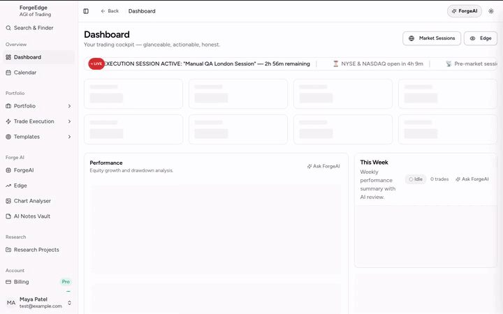
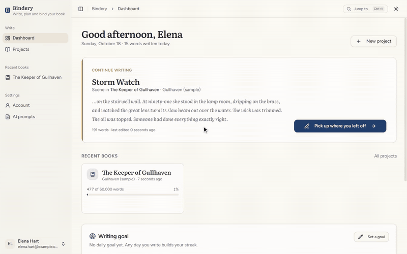

<h1 align="center">Rachit Asthana</h1>

  

  
  
  
  

I build AI software end to end, from the model calls and agent plumbing to the app people install. Most of it is local-first and keeps your keys and data on your own machine. Four projects are published where people install them: the KDE Store, Obsidian's community plugins, npm and the official MCP Registry.

  <a href="#kde-ai-chat"><b>KDE AI Chat</b></a> ·
  <a href="#ai-scheduler-for-obsidian"><b>AI Scheduler</b></a> ·
  <a href="#progressor"><b>Progressor</b></a> ·
  <a href="#antigravity-updater"><b>antigravity-updater</b></a> ·
  <a href="#forgeedge"><b>ForgeEdge</b></a> ·
  <a href="#bindery"><b>Bindery</b></a>

## Featured projects

### [KDE AI Chat](https://github.com/racstan/KDE-AI-Chat)

· [13-min tour](https://youtu.be/SnkKFCN_Jkg)

A chat assistant in the KDE Plasma 6 panel. It talks to cloud providers or to models on your own computer, and can hand a chat to the OpenCode or Pi coding agent. API keys are kept in KDE Wallet, and chats stay in private files on your machine.

<b>What it does</b>

- **Many providers.** OpenAI, Anthropic, Gemini, OpenRouter, Groq, Mistral and more, plus Ollama and LM Studio. It finds local servers by itself.
- **Three modes.** Chat with a provider directly, or through the OpenCode or Pi coding agent with their tools and permissions.
- **Organised chats.** Projects, search across all chats, incognito chats, quotes, edit and rewind, slash commands, export.
- **Memory and personality.** Tell it who you are and what to remember.
- **Scheduled messages.** Sent into a chat at set times, even while the widget is closed.
- **Voice.** Dictation and read-aloud through Speech Note, both off until you switch them on.
- **Desktop integration.** Ask from KRunner, from Dolphin, or about selected text in any app.
- **Pictures.** `/image` through AI Horde or Pollinations, and pictures sent back by models.

### [AI Scheduler for Obsidian](https://github.com/racstan/obsidian-ai-scheduler)

Runs AI tasks in your Obsidian vault on a schedule, at a set time, or when notes change. You describe a task once in plain English and it plans, schedules and runs it, writing the result into your vault. It drives the AI plugin you already use (Claudian, Oh My Claudian or Copilot) and handles only scheduling and execution.

<b>What it does</b>

- **Any cadence.** Daily, weekly, every N minutes, hours or days, 5-field cron, one-shot, when a note changes (with a cooldown), or after another task finishes.
- **Natural-language planner.** "Every Friday afternoon, summarize this week's project notes" becomes a configured task.
- **Results where you want them.** A new note per run, one note replaced or appended to (optionally under a heading), or today's daily note.
- **Approval mode.** Changes to existing notes wait as diffs for you to approve or reject.
- **Variables.** `{{changed_notes}}`, `{{last_run}}`, `{{daily_note}}`, Dataview queries, calendar events and more, filled in at run time.
- **Reliable runs.** Retries, time limits, "only if something changed", quiet hours, pause, and a 20-run history per task.
- **Calendar.** Month, agenda and day views, plus an `.ics` file of upcoming runs for Google, Outlook or Apple Calendar.
- **Mobile.** Plan and edit tasks on phones and tablets; a per-device setting picks which device runs them.

### [Progressor](https://github.com/racstan/progressor-mcp)

· [4-min video](https://youtu.be/7jDyJZvDMag)

An MCP server that keeps an AI coding agent on its plan. The agent writes its goal and steps into your project folder and keeps them up to date. After a chat's context is compressed, in a new chat, or even in a different AI app, it reads the plan and carries on where the work stopped. A local dashboard shows the same plan live.

<b>What it does</b>

- **Works across apps.** Claude Code, Claude Desktop, VS Code with Copilot, Cursor, Windsurf, Codex and any other MCP client.
- **Plan stored in your project.** Goals, steps, side trips, decisions, notes and rules are plain Markdown files, kept out of git by default.
- **Live dashboard.** The current step, finished steps with times, side trips drawn as a route map, and estimates against actual time.
- **Needs you.** Questions and things to try by hand wait on the dashboard, answered with a click.
- **Two-way.** Write to the AI from the dashboard; it replies there.
- **Recovers after compaction.** In Claude Code, hooks put the plan back in front of the agent automatically.

### [antigravity-updater](https://github.com/racstan/antigravity-updater)

Google Antigravity has no built-in updater on Linux. `npx antigravity-updater` finds your installs, checks the latest IDE and `agy` CLI versions, backs up the current IDE, closes it safely, and installs the update.

<b>How it works</b>

1. Finds installs in the usual places and from running processes, or takes a path you type.
2. Compares installed versions with Google's latest IDE and CLI releases.
3. Lets you update the IDE, the CLI or both.
4. Backs up the IDE to `<install path>.bak` before changing anything.
5. Stops running IDE processes so no files are locked.
6. Downloads the official tarball with a progress bar, extracts it and fixes permissions.
7. Updates the CLI with Google's official install script.

It only talks to Google's release servers, and `--check` looks for updates without installing anything.

### ForgeEdge

An AI workspace for understanding trading better: a journal, research, a rule book and a coach for forex and prop-firm traders. The work is done by ForgeAI, an agent system built into the app. A fast classifier screens each request, routes it to one of 50 specialist agents, and checks the trader's messages for tilt before an LLM is ever called.

  <picture>
    <source media="(prefers-color-scheme: dark)" srcset="profile/media/forgeedge-tour-dark.gif">
    
  </picture>

<b>What's inside</b>

- **Trading workspace.** Journal, analytics, Scalper Desk, economic calendar, chart analyzer, rule book with checklists, prop-firm challenge tracking and a coach.
- **ForgeAI orchestration.** Requests go through a gateway into a queued orchestrator that delegates to specialist agents (trade analysis, research, debate, strategy, chart, data ingest, code generation) and streams results back over WebSockets.
- **System-1 sidecar.** A Python FastAPI service screens prompts for jailbreaks and injection, routes intent (cutting the tool list from 45 to 2 or 3), estimates pre-trade risk, and detects FOMO and revenge trading. Each call takes about 33 ms.
- **Deterministic maths, not guesses.** Position sizing per instrument (forex lots, gold, indices, crypto), drawdown episodes, and statistical significance for trade stats (t-statistic, 95% confidence interval, small-sample warnings).
- **Measured.** A 100-scenario capability evaluation (95 supported, 5 partial), about 360 PHP test files, PHPStan and Pint, plus code-level audits of the database, backend and frontend.
- **Operator tooling.** A `fe:*` CLI for switching AI modes and models, tuning parameters and JSON output; Docker and one-command dev scripts for Linux and Windows.

Stack: Laravel 12, Inertia, React + TypeScript, PostgreSQL, Redis + Horizon, Laravel Reverb, Python FastAPI.

### Bindery

An AI-assisted app for writing, planning and producing books. You write and the AI co-writes, or the AI drafts and you edit. A story bible keeps characters, places and lore correct for the point in the story you're at, and the finished book exports as print-ready files.

  <picture>
    <source media="(prefers-color-scheme: dark)" srcset="profile/media/bindery-tour-dark.gif">
    
  </picture>

<b>What's inside</b>

- **Two ways to write.** Co-writer (you write, the AI helps) or ghostwriter (the AI drafts, you edit), with AI text streamed live into the editor.
- **Story bible with inheritance.** Characters, places, lore and plot threads, which the AI sees as they stand at the current point in the story.
- **Book production.** Front and back matter, page-layout rules, images and templates.
- **Exports.** PDF (headless Chrome with Paged.js, matching the preview), EPUB, Word, Markdown and HTML, built on a queue.
- **Per-task models.** Admins pick an OpenRouter model for each job (chat, summarize, continue, rewrite, draft, outline, analysis).
- **Tested offline.** The test suite fakes every AI and HTTP call.

Stack: Laravel 13, Inertia 2, React 19 + TypeScript, Tailwind + shadcn/ui, MySQL, Laravel Reverb, Laravel AI SDK.

## Tech I work with

   
   
  

<b>More public projects</b>

 

| Project | What it is |
| --- | --- |
| [hastejev](https://github.com/racstan/hastejev) | Non-generative "System-1" decision engine in Python: calibrated answers over a fixed set of choices in under 15 ms. |
| [pi-reddit](https://github.com/racstan/pi-reddit) | Reddit tools for the Pi coding agent through a local MCP server; read-only by default, every write needs confirmation. |
| [pi-muse-connector](https://github.com/racstan/pi-muse-connector) | REST API that connects Meta Muse to the Pi coding agent for coding tasks. |
| [opencode-freellmapi](https://github.com/racstan/opencode-freellmapi) | OpenCode plugin that keeps FreeLLMApi providers and models in sync. |
| [ai-release-notes](https://github.com/racstan/ai-release-notes) | Generates categorized release notes from commit history with AI, with fallbacks. |
| [Anchor](https://github.com/racstan/Anchor) | Local-first workspace for ideas and decisions: React + Tauri on web, desktop and Android ([live demo](https://anchor-chi-eight.vercel.app)). |
| [goodlogger](https://github.com/racstan/goodlogger) | Local web app for custom data-logging templates with 14 field types, projects and CSV export; no cloud, no telemetry. |
| [WishlistManager](https://github.com/racstan/WishlistManager) | Self-hosted Next.js workspace for wishlists, todos, notes and schedules. |
| [Open-Pacer](https://github.com/racstan/Open-Pacer) | Android app that tracks and analyses repetitive practice: sports, skills, study. |
| [element-picker](https://github.com/racstan/element-picker) | Chrome extension that turns a hovered element into clean HTML/CSS or a Markdown bug report. |
| [Clipboard-UI](https://github.com/racstan/Clipboard-UI) | Web app that turns copied text into editable cards, with import and export ([live](https://clipboardui.netlify.app)). |
| [didilang](https://github.com/racstan/didilang) | A toy programming language in Hindi slang.   |
| [rastanengine](https://github.com/racstan/rastanengine) | A 2D game engine in Python with a Flappy Bird clone built on it. |
| [racbrutal](https://github.com/racstan/racbrutal) | A small pygame arena game: swing a growing flail and grab power-ups. |
| [Data-Science-Projects](https://github.com/racstan/Data-Science-Projects) | Machine-learning notebooks, starting with taxi trip prediction. |
| [R-codes](https://github.com/racstan/R-codes) | Statistics in R: distributions, ANOVA, chi-squared and F tests, regression. |
| [cses](https://github.com/racstan/cses) | Solutions to CSES and other algorithm problems in C++. |

<b>GitHub activity</b>

 

## Contact

Tutorials and demos of my projects go up on [YouTube](https://www.youtube.com/@rastanid).

  
  
  
  
  
  
  

